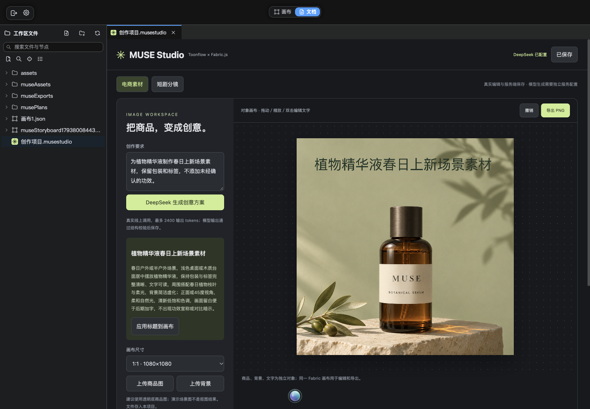

# MUSE Studio

面向电商素材与短剧分镜的 AI 创作工作台，包含可直接分享的交互原型、开源集成源码和三份产品方案。

**[在线体验](https://weiweidounais.github.io/muse-studio/)** · **[集成实测展示](https://weiweidounais.github.io/muse-studio/integration-preview.html)**

## 展示范围

| 版本 | 可以体验什么 | 模型与数据 |
|---|---|---|
| GitHub Pages 在线演示 | 两个场景、画布标题编辑、PNG、分镜 JSON、模拟任务、失败重试与本浏览器保存 | 预置素材与模拟任务，不调用模型，不需要密钥 |
| Toonflow 开源集成版 | Fabric 对象编辑、真实 DeepSeek 创意／四镜头脚本、服务端保存、8 节点工作流、FFmpeg 静帧 MP4 | 在自己的服务器或电脑运行；配置自己的 DeepSeek，图像／视频模型另行接入 |

GitHub Pages 承载静态网页。仓库中的服务端源码不会随 Pages 部署而自动运行；在线站点没有公开付费模型接口，也不包含 API 密钥。



## 产品方案

1. [模型选型与评估方案](docs/01-模型选型与评估方案.md)
2. [场景与用户说明](docs/02-场景与用户说明.md)
3. [产品策略与技术方案](docs/03-产品策略与技术方案.md)

[实际验证记录](evidence/开源集成验收记录.md) · [20 秒静帧 MP4](evidence/开源集成-分镜静帧.mp4)

展示图片为预置的虚构商品与剧照。MP4 使用同一剧照的四次上传验证编码链路，不能据此评估镜头多样性或角色一致性。

## 在本地打开交互原型

```sh
git clone https://github.com/weiweidounais/muse-studio.git
cd muse-studio
python3 -m http.server 8765 --bind 127.0.0.1 --directory studio-demo/dist
```

访问 http://127.0.0.1:8765 。不需要安装前端依赖。

## 运行开源集成版

需要 Bun 1.4.3，以及匹配系统的 FFmpeg / FFprobe。完整源码位于 `integration/toonflow/`，上游基线是 [Toonflow ecd5325](https://github.com/HBAI-Ltd/Toonflow-app/tree/ecd5325c7f9b38721491382ee6952fa2318b4693)。遵循该目录的开发规范。

```sh
cd integration/toonflow
bun install --frozen-lockfile
bun run --cwd apps/web build
bun run build:nodes
bun run build:tools
bun run build:ext
bun run --cwd apps/server build
mkdir -p data/workspaces
cp -R ../../examples/museProject data/workspaces/museProject
TOONFLOW_SERVER_PORT=3010 bun build/server/index.js
```

访问 http://127.0.0.1:3010 ，选择服务器工作区 `museProject`，进入「文档」并打开 `project.musestudio`。没有密钥时可编辑素材；真实模型调用需要先配置。FFmpeg 可通过 Toonflow 设置安装或指定已有程序路径。

在仓库根目录运行下面的命令，可通过终端隐藏输入填写自己的 DeepSeek 密钥；密钥只写入被 Git 忽略的服务端私有配置。不要将真实密钥填入前端源码、公开仓库或 Pages 设置。

```sh
python3 -c 'import getpass,json; print(json.dumps({"key":getpass.getpass("DeepSeek API Key: ")}))' | bun integration/configureDeepseek.mjs
```

配置完成后重启服务。MUSE 使用官方 DeepSeek 接口、`deepseek-flash` 和服务端引用；单次生成最多 2400 输出 tokens，不自动重试。图像与动态视频生成仍需对应 Provider 的账号和模型。

## 代码与来源

- `studio-demo/dist/`：无构建的 HTML / CSS / JavaScript 在线演示。
- `integration/toonflow/packages/ext/museStudio/`：MUSE 扩展及 Fabric 编辑器。
- `integration/toonflow/apps/server/src/routes/muse/`：创意、分镜与视频导出接口。
- `examples/museProject/`：没有密钥、调用记录或私人数据的起始项目。
- `docs/` 与 `evidence/`：方案、截图、样例导出和手工验证范围。

本仓库不包含已配置密钥、用户工作区、依赖目录或运行时二进制。服务默认只监听本机，公网真实模型服务需要另行部署、鉴权、项目隔离与预算控制。

第三方 Toonflow 源码保留其 [MIT 许可证](integration/toonflow/LICENSE) 与原作者版权。Fabric.js、FFmpeg 等依赖遵循各自许可证；详情见 [第三方来源](THIRD_PARTY_NOTICES.md)。
