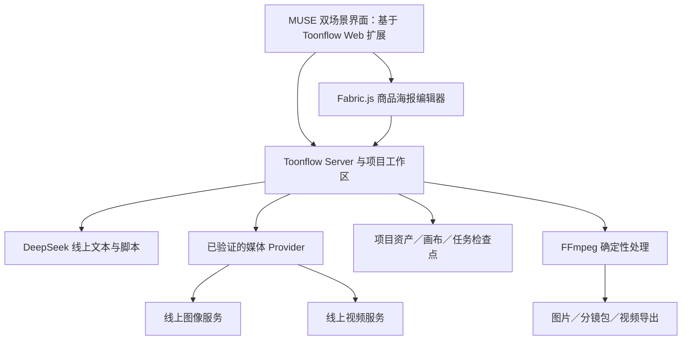

# MUSE Studio｜产品策略与开源技术方案

> 版本：v1.3 · 2026-11-04  
> 文档类型：产品策略、GitHub 开源选型与实施方案  
> 产品范围：电商素材、批量短剧两个创作场景；推理使用线上模型服务，DeepSeek 负责文本与脚本。  
> 实施状态：已在本机隔离部署 Toonflow，集成 Fabric.js、真实 DeepSeek 创意与分镜、FFmpeg 静帧 MP4；图像／视频模型尚未配置。现有交互原型继续保留。

## 1. 方案结论

采用 **Toonflow 作为创作工作台底座，Fabric.js 补齐商品海报图层编辑，复用底座已有的 DeepSeek、媒体生成与 FFmpeg 能力**。先验证原生任务恢复，再决定是否增加 BullMQ 持久队列。

这一路线保留 MUSE 的双场景产品结构与交互要求，将下一阶段的研发重点放在商品约束、脚本确认、版本关联和交付验收上。当前原型不直接替换，也不将多个完整应用拼接成彼此独立的工作台。

| 层级 | 采用方案 | 解决的问题 | 采用方式 |
|---|---|---|---|
| 创作工作台与短剧流程 | [HBAI-Ltd/Toonflow-app](https://github.com/HBAI-Ltd/Toonflow-app) | 项目、无限画布、文本／图像／视频节点、参考资产与模型配置 | 锁定源码后进行二次开发，承接 MUSE 双场景入口 |
| 电商海报编辑 | [fabricjs/fabric.js](https://github.com/fabricjs/fabric.js) | 商品／背景／文案的独立图层、对象变换、序列化与图片导出 | 在电商场景中嵌入对象画布，保存为专用文档类型 |
| 生成任务与恢复 | Toonflow 原生生成机制 | 任务 ID、检查点、节点状态、结果恢复 | 先执行故障验收，保留已存在的能力 |
| 后台并发调度 | [taskforcesh/bullmq](https://github.com/taskforcesh/bullmq)，条件引入 | 跨 Worker 并发上限、队列、退避与进程故障恢复 | 原生机制不满足后台运行要求时，再以独立服务引入 |
| 视频处理 | Toonflow 已集成的 [FFmpeg](https://github.com/FFmpeg/FFmpeg) 能力 | 片段处理、音视频与字幕处理、最终文件输出 | 先验证原有接口能否满足本产品导出规格 |
| 业务规则 | MUSE 扩展模块 | 商品事实锁定、角色版本、脚本确认、预算与交付审核 | 围绕上述底座增量开发 |

集成结果以第 9 节实际记录为准；候选方案、未来能力与正式模型效果评估分别管理。

## 2. 产品目标与选型标准

### 2.1 产品目标

- 电商：从商品原图与创作要求生成场景素材，保留包装和商品信息，支持独立编辑与多尺寸交付。
- 短剧：从故事与角色设定形成可审阅分镜，逐镜头生产、重试、预览并导出。
- 共享：项目与资产一致、生成过程可追踪、编辑与生成互不阻塞、异常后能恢复成果。

业务质量以“用户接受的可交付产物”衡量；生成次数、工作流执行成功和文件下载成功分别记录。

### 2.2 选型标准

| 标准 | 本项目的判断条件 |
|---|---|
| 业务覆盖 | 能承接图像与视频任务、参考资产及分镜，而非只提供聊天入口 |
| 线上模型接入 | 能使用自有 API 配置；不要求购买本地 GPU 或改回本地推理路线 |
| 可修改与扩展 | 有清晰的前后端、节点或供应商入口，可加入电商模块与用户确认点 |
| 许可可用性 | 核对具体版本的 LICENSE；不把“代码公开”直接等同于允许任意二次开发 |
| 持久化与恢复 | 保存任务身份和原始输入；重连先查已有任务，避免重复生成与扣费 |
| 交付能力 | 图层与视频片段能变成可继续编辑、可导出的成果 |
| 验证成本 | 优先复用已存在的机制，新增基础设施须有明确的验收缺口作为依据 |

本次未以 Star 数量打分；仓库热度不能替代许可、源码和真实任务验证。

## 3. GitHub 候选比较

| 项目 | 已核实能力 | 主要缺口或约束 | 结论 |
|---|---|---|---|
| **Toonflow** | README 描述文本、图片、视频节点及角色／场景素材；源码含 DeepSeek 入口、媒体生成检查点和节点恢复 | 商品海报图层不是其主业务；服务无独立登录鉴权；本产品的预算、事实锁定和跨任务策略仍需补充 | **主选底座** |
| **BeatDesign** | 同项目共享 Canvas、资产与视频 Editor；原生时间线与 MP4 导出；Apache-2.0 | 当前定位为单用户 localhost 应用，无账户边界；默认 BeatAPI，其他协议需供应商适配；产品文档明确排除托管协作 | **视频编辑优先时的备选** |
| **Fabric.js** | 对象缩放、移动、旋转、分组及 PNG／JSON／SVG 等输入输出；MIT | 是编辑库，不提供 AI 工作流、任务调度和用户体系 | **用于电商编辑模块** |
| **BullMQ** | 队列、Worker 并发、全局并发与失败退避；MIT | 依赖 Redis 服务；外部推理的幂等、取消和费用对账仍是业务责任 | **按缺口引入** |
| **Jaaz** | README 描述多模态画布、图像／视频与云模型 | 当前 LICENSE 为自定义社区／商业双重许可，修改、团队部署和衍生产品需要商业授权 | **不作为默认二次开发底座** |
| **Huobao Drama** | README 描述剧本、角色、分镜和视频合成 | 当前 LICENSE 为 CC BY-NC-SA 4.0，包含非商业限制 | **不纳入可自由商用改造的主方案** |

来源：[Toonflow README](https://github.com/HBAI-Ltd/Toonflow-app/blob/master/README.md) · [Toonflow LICENSE](https://github.com/HBAI-Ltd/Toonflow-app/blob/ecd5325c7f9b38721491382ee6952fa2318b4693/LICENSE) · [BeatDesign README](https://github.com/BeatAPI/BeatDesign/blob/main/README.md) · [BeatDesign 架构与边界](https://github.com/BeatAPI/BeatDesign/blob/main/docs/ARCHITECTURE.md) · [Fabric.js README](https://github.com/fabricjs/fabric.js/blob/master/README.md) · [BullMQ 并发](https://github.com/taskforcesh/bullmq/blob/master/docs/gitbook/guide/workers/concurrency.md) · [Jaaz LICENSE](https://github.com/11cafe/jaaz/blob/main/LICENSE) · [Huobao LICENSE](https://github.com/chatfire-AI/huobao-drama/blob/master/LICENSE)。

### 3.1 版本与许可边界

Toonflow 本方案锁定核对的源码提交为：

```text
仓库：HBAI-Ltd/Toonflow-app
分支：master
提交：ecd5325c7f9b38721491382ee6952fa2318b4693
提交时间：2026-11-02 12:54:59 UTC
本次核查日期：2026-11-04
```

该提交的 LICENSE 为 MIT。仓库 README 同时说明历史版本存在不同许可，因此后续应按锁定提交及其依赖核验，不能将当前 MIT 结论套用到所有旧版本。选型时保留版权与许可文件，第三方节点、插件、素材及线上模型服务分别核对条款。[锁定提交](https://github.com/HBAI-Ltd/Toonflow-app/commit/ecd5325c7f9b38721491382ee6952fa2318b4693) · [版本说明](https://github.com/HBAI-Ltd/Toonflow-app/blob/ecd5325c7f9b38721491382ee6952fa2318b4693/README.md)。

Fabric.js 与 BullMQ 主仓库当前为 MIT；依赖服务不随主库自动获得同一许可。FFmpeg 的实际适用许可取决于构建选项及外部组件，包含 GPL 组件的构建不能统一标为 LGPL。[Fabric LICENSE](https://github.com/fabricjs/fabric.js/blob/master/LICENSE) · [BullMQ LICENSE](https://github.com/taskforcesh/bullmq/blob/master/LICENSE) · [FFmpeg LICENSE](https://github.com/FFmpeg/FFmpeg/blob/master/LICENSE.md)。

## 4. 主方案的源码依据与复用边界

### 4.1 Toonflow 已有能力

| 需求 | 仓库证据 | 可以复用的内容 | 仍需验证或开发 |
|---|---|---|---|
| DeepSeek 接入 | `packages/providers/src/language/deepSeek.ts` | 已有 DeepSeek 供应商定义，API URL 为 `https://api.deepseek.com`，协议为 `openai-completions` | 配置当前账户可用模型，验证结构化脚本、超时、截断与错误处理 |
| 图像／视频供应商扩展 | `packages/providers/index.ts` | 语言与媒体供应商分离；当前媒体入口包含 apiMart、metaso、compshare | 第一份模型方案中的 FLUX.2／Runway 不等于已原生接入；需自定义适配或另选已验证服务 |
| 生成状态与恢复 | `packages/nodeShared/src/useNodeGeneration.ts` | 保存 taskId、providerId、modelId、恢复数据与 applied 状态；已有复查任务与避免重复提交逻辑 | 浏览器关闭、服务重启、不同供应商的恢复行为须逐项实测 |
| 媒体检查点 | `apps/server/src/utils/media/generation.ts` | 已有 providerData、远程资产、文件与 hash 等检查点结构；复用媒体类型校验及结果下载逻辑 | 检查持久化时机、异常期间的费用记录和资源归属 |
| FFmpeg 处理 | `packages/ffmpeg/`、服务端 `routes/ffmpeg/` | 已有执行、进度、取消和状态接口，可用于确定性媒体处理 | 本产品的镜头顺序、字幕、编码规格与后台导出任务需单独验收 |
| 界面和扩展 | `apps/web/`、`packages/nodes/`、`packages/ext/` | Vue 工作台、现有节点与扩展机制 | 将 MUSE 双场景页面迁移成业务模块，并增加商品画布 |

源码入口：[DeepSeek](https://github.com/HBAI-Ltd/Toonflow-app/blob/ecd5325c7f9b38721491382ee6952fa2318b4693/packages/providers/src/language/deepSeek.ts) · [供应商注册](https://github.com/HBAI-Ltd/Toonflow-app/blob/ecd5325c7f9b38721491382ee6952fa2318b4693/packages/providers/index.ts) · [节点恢复](https://github.com/HBAI-Ltd/Toonflow-app/blob/ecd5325c7f9b38721491382ee6952fa2318b4693/packages/nodeShared/src/useNodeGeneration.ts) · [媒体检查点](https://github.com/HBAI-Ltd/Toonflow-app/blob/ecd5325c7f9b38721491382ee6952fa2318b4693/apps/server/src/utils/media/generation.ts) · [FFmpeg 执行接口](https://github.com/HBAI-Ltd/Toonflow-app/blob/ecd5325c7f9b38721491382ee6952fa2318b4693/apps/server/src/routes/ffmpeg/execute.ts)。

源码中存在对应实现，不等于它已在本项目配置和工作负载下通过验收。尤其是 DeepSeek 定义的 `models` 初始为空，不能据此声称当前模型名单或全部模型特性已适配。

### 4.2 两类画布必须分开设计

- **工作流画布**：使用 Toonflow 原有节点体系，表达输入、参考、生成与结果之间的关系，负责组织创作过程。
- **海报对象画布**：使用 Fabric.js，表达背景、商品、遮罩、标题等对象及其位置、层级和样式，负责精确编辑和图片导出。

工作流图不直接承担海报排版。两者通过 `assetId` 与 `canvasVersion` 关联：工作流生成资产，商品画布引用具体资产；编辑海报不反向覆盖上游生成历史。

## 5. 产品架构与部署路线

### 5.1 第一阶段：单用户完整闭环



优先复用 Toonflow 当前的工作区与项目格式，不先将整个应用迁移为另一套数据库架构。MUSE 增加商品事实、脚本确认签名、角色版本、费用确认和审核状态等业务字段，关联到项目及具体节点／资产。

当前源码是 Bun 单仓多包结构：Web 使用 Vue、Vite 与 Vue Flow，Server 使用 Bun 与 Express；不沿用旧版本介绍中的技术栈。具体运行版本以锁定提交的 `package.json` 和锁文件为准。[根包配置](https://github.com/HBAI-Ltd/Toonflow-app/blob/ecd5325c7f9b38721491382ee6952fa2318b4693/package.json) · [Web 包](https://github.com/HBAI-Ltd/Toonflow-app/blob/ecd5325c7f9b38721491382ee6952fa2318b4693/apps/web/package.json) · [Server 包](https://github.com/HBAI-Ltd/Toonflow-app/blob/ecd5325c7f9b38721491382ee6952fa2318b4693/apps/server/package.json)。

### 5.2 第二阶段：按验收缺口增加后台调度

满足以下任一条件且原生机制无法通过验收时，再引入 BullMQ：

1. 多项目同时生成，需要按供应商账户统一限制并发。
2. 浏览器关闭或导出请求断连后，任务仍必须由后台继续执行。
3. Worker 崩溃后需要自动接管，并先核对已有供应商任务。
4. 需要独立的重试计划、排队优先级和审计记录。

```text
MUSE 业务 API → 持久任务台账 → BullMQ / Redis 服务 → 独立 Worker
                         ↑                       ↓
                   状态事件与对账 ← Provider 查询／生成／FFmpeg
```

队列只保存任务 ID 与不可变输入引用，不保存大图片、视频或明文密钥。任务台账记录快照、尝试、供应商任务 ID、费用与结果；若现有工作区格式不足以支持此类事务记录，再为新增服务引入 PostgreSQL，而不是提前改写全部项目数据。

BullMQ 的 Node Worker 不默认直接导入依赖 Bun 的 Toonflow 服务端模块；通过明确的内部 API 或经过兼容性验证的适配层调用。每项任务只允许一个调度入口，避免原生节点与 BullMQ 同时提交同一次付费生成。

### 5.3 部署边界

- 单人验证优先使用官方 Docker／服务器方式，模型推理走线上 API，无须准备本地 GPU。
- 官方 Compose 将端口绑定到 `127.0.0.1:3000`，项目数据放在 `toonflowData` 卷；备份需覆盖配置与完整工作区。
- 当前 README 明确业务页面与 API 没有独立登录鉴权；公网部署前必须增加带认证的反向代理，团队服务还需要项目归属与权限隔离。
- 现有 Sites 静态 Demo 仅继续承载演示和文档；Bun 服务、持久 Worker 与 FFmpeg 需要独立的适合运行这些进程的环境。

部署依据：[Compose](https://github.com/HBAI-Ltd/Toonflow-app/blob/ecd5325c7f9b38721491382ee6952fa2318b4693/compose.yaml) · [README 部署与访问说明](https://github.com/HBAI-Ltd/Toonflow-app/blob/ecd5325c7f9b38721491382ee6952fa2318b4693/README.md)。本机采用源码构建方式部署，不使用 Docker；实际配置见第 9 节。

## 6. 双场景落地方案

### 6.1 电商素材

```text
商品原图 → 商品事实确认 → DeepSeek 创作 brief → 用户选择方向与预算
        → 背景／场景生成 → 商品层与背景合成 → Fabric.js 编辑
        → 标签／包装与尺寸检查 → 多尺寸导出
```

| 模块 | 复用部分 | MUSE 增量 |
|---|---|---|
| 商品导入 | 原有图片导入与资产组织 | SKU、商品事实、原图 hash 与不可修改区域 |
| 创意规划 | 文本节点与 DeepSeek 入口 | 结构化 brief、缺失事实提示、用户确认 |
| 生成 | 图像节点与媒体 Provider | 商品保真策略、方向／尺寸拆分及预算确认 |
| 编辑 | Fabric.js 的图像、文本、变换、分组和序列化 | 图层面板、商品层锁定、多比例模板、撤销与项目版本 |
| 导出 | 图片输出及底座资产管理 | 文件命名、SKU／尺寸映射、导出清单和质量状态 |

Fabric.js 不提供自动抠图或商品真实性保证：透明底商品素材需由用户提供，或另接已验证的抠图服务。AI 重绘商品也不能替代商品事实验收。

### 6.2 批量短剧

```text
故事梗概与角色参考 → DeepSeek 分镜草稿 → 用户确认脚本及角色版本
                  → 逐镜头分镜图 → 静帧审核 → 逐镜头视频
                  → 连续性审核 → FFmpeg 编排与导出
```

| 模块 | 复用部分 | MUSE 增量 |
|---|---|---|
| 故事与资产 | 文本节点、角色／场景参考、工作区 | 角色版本、镜头编号、素材来源与授权记录 |
| 分镜脚本 | DeepSeek 接入及文本工作流 | 镜头数、时长、角色引用的结构校验；确认签名 |
| 画面与视频 | 图片／视频节点与媒体检查点 | 单镜头审核、预算上限、参考版本和输出归属 |
| 异常恢复 | 原生任务身份与恢复入口 | 产品级聚合状态、恢复提示、费用核对与人工放弃 |
| 成片 | FFmpeg 接口及片段资产 | 固定镜头顺序、字幕样式、格式校验与导出版本 |

角色一致性不能由“使用同一开源工具”保证；它依赖参考输入、模型能力、镜头设计与人工审核。故事或角色修改后，旧任务保留原快照，新任务必须重新确认。

## 7. 并发、中断与失败恢复

### 7.1 先复用，再补缺口

Toonflow 已有保存任务身份、复查已有任务和恢复数据的源码，不应将这些能力全部重写。第一轮验证以原生机制为基线，分别测试图像、视频与 FFmpeg；不能以一个供应商能恢复推断其他供应商也能恢复。

其中，已查看的 FFmpeg 执行路由使用进程内 `Map` 管理活动请求，并监听连接关闭进行中断；因此本产品若要求“关闭页面后仍可靠完成导出”，需要独立验证或改成后台任务。该观察只针对所核查路由，不等于对整个仓库可靠性的结论。

### 7.2 BullMQ 的使用边界

| 要求 | 开源组件可提供的能力 | 仍需业务实现 |
|---|---|---|
| 并发上限 | Worker concurrency、队列全局并发 | 按供应商账户分队列；用户公平性与预算额度 |
| 失败重试 | attempts、指数退避、jitter | 只重试明确失败；结果未知先对账 |
| 故障接管 | Worker 队列处理与 stalled 机制 | 恢复供应商任务、幂等落库，避免再次付费提交 |
| 取消 | 配合应用状态控制等待任务 | 运行中向供应商请求取消；未确认前不承诺已停止或退款 |
| 父子依赖 | 按任务／批次组织处理 | 镜头与版本关联、部分成功状态和用户确认点 |

Worker 的并发参数仅限制该实例，不等于所有 Worker 的总并发。需要全局上限时使用队列全局并发配置。BullMQ 文档描述至少一次处理语义，外部推理仍必须幂等；去重不能只依赖某个 Job 完成状态。[并发机制](https://github.com/taskforcesh/bullmq/blob/master/docs/gitbook/guide/workers/concurrency.md) · [全局并发](https://github.com/taskforcesh/bullmq/blob/master/docs/gitbook/guide/queues/global-concurrency.md) · [失败退避](https://github.com/taskforcesh/bullmq/blob/master/docs/gitbook/guide/retrying-failing-jobs.md)。

### 7.3 业务状态与数据约束

```text
草稿 → 已确认 → 排队 → 执行 → 校验 → 完成
                         ├→ 明确失败 → 允许重试
                         ├→ 结果未知 → 按供应商任务 ID 复查
                         └→ 请求取消 → 确认取消／已完成
```

最小数据约束：

- 每个任务绑定项目、镜头或素材编号、输入快照 hash、模型与参考资产版本。
- 提交即保存业务任务 ID；获得供应商 ID 后及时持久化，后续重连优先查询。
- 重试复用原快照；采用新设置时创建新任务，不覆盖已完成结果。
- 旧结果返回后进入历史资产，不自动覆盖用户已经修改的画布。
- 图像／视频任务完成与业务质量通过分别记录；用户验收后才计入合格交付。
- 队列、配置和项目文件都需备份；浏览器 localStorage 不作为正式项目的唯一副本。

## 8. 开源验证与实施计划

| 阶段 | 主要动作 | 交付物与准入条件 |
|---|---|---|
| A：底座验证 | 在独立目录锁定 Toonflow 提交；使用测试项目配置 DeepSeek 与一个媒体 Provider | 能保存项目、执行一次真实文本及单图任务、重开读取；不覆盖现有 Demo |
| B：短剧闭环 | 验证脚本确认、参考图、单镜头视频、任务恢复与 FFmpeg | 四镜头示例可审阅、逐项重做并导出真实文件，来源与费用可追溯 |
| C：电商模块 | 嵌入 Fabric.js，接入商品层与背景生成 | 商品层可锁定，标题可编辑，三种比例导出与画布一致 |
| D：并发与恢复 | 对原生机制执行故障注入，按缺口增加 BullMQ | 多任务不重复提交、故障可恢复、旧结果不覆盖新编辑 |
| E：服务化 | 补充认证、项目隔离、预算和审计 | 未授权不可读取／提交他人项目；密钥不进入前端与日志 |

阶段 A 的隔离验证命令参考如下，仅用于明确方案，尚未执行：

```bash
git clone https://github.com/HBAI-Ltd/Toonflow-app.git Toonflow-evaluation
cd Toonflow-evaluation
git checkout ecd5325c7f9b38721491382ee6952fa2318b4693
docker compose up -d --build
```

随后按锁定版本文档在界面配置模型。API Key 通过私有配置提供，不写入本报告、源码或公开示例。构建和 API 调用需要网络，线上生成另有服务费用；开源软件许可不免除模型、存储和带宽成本。

### 8.1 必须通过的故障验收

| 用例 | 预期结果 |
|---|---|
| 生成中关闭浏览器再打开 | 查回原任务与结果，不新增一次付费生成 |
| 服务进程在提交后重启 | 依据已保存状态恢复或明确提示结果未知，不盲重试 |
| 一个镜头失败、其他镜头成功 | 保留成功产物，只重试失败镜头 |
| 用户修改角色后旧任务返回 | 结果归属旧角色版本，不覆盖新分镜 |
| 重复提交／重复回调 | 不重复创建逻辑任务或重复计入合格产物 |
| 供应商返回 429、5xx 或超时 | 区分限流、明确失败和结果未知；遵循预算与对账策略 |
| 导出时断连 | 按约定继续后台执行，或明确标为中断并可恢复 |
| 多 Worker 同时运行 | 总并发不超过账户配置上限，不能只检查单实例参数 |
| 商品包装或标签改变 | 标为不合格，允许回到锁商品层的制作路径 |
| 项目存储或导出失败 | 保留已确认版本与已有结果，错误可见且可重试 |

这些是后续开源集成的验收用例，不能用现有静态 Demo 的模拟任务测试替代。

## 9. 部署结果与验证报告

### 9.1 部署形态

本次面试展示采用本机单进程 Web 服务，访问 **http://127.0.0.1:3010**，仅监听回环地址。源码与便携运行环境置于 `integration/`，原 `studio-demo/` 独立保留。本次没有部署公网生产服务。

| 项目 | 已部署配置 |
|---|---|
| 开源基线 | Toonflow 提交 `ecd5325c7f9b38721491382ee6952fa2318b4693`，保留 MIT 许可证 |
| 运行时 | 工作区内便携 Bun 1.4.3；Vue、Vite、Express 沿用上游 |
| 电商编辑 | Fabric.js 7.4.0；MUSE 文档扩展 0.1.2 |
| 文本模型 | 官方 `https://api.deepseek.com`，`deepseek-flash`，关闭思考、JSON 输出、最多 2400 输出 tokens |
| 视频编码 | FFmpeg / FFprobe 6.1.1；H.264、24fps，横屏 960×540 或竖屏 540×960 |
| 项目存储 | 服务端文件工作区；图片用相对路径引用，JSON 快照原子保存 |
| 密钥存储 | 私有配置权限 0600；设置接口仅返回服务端引用，真实 DeepSeek 密钥不下发前端 |

双击 `integration/startMuse.command` 启动并打开；`stopMuse.command` 只停止本项目记录的进程，保留文件。详见 [部署与使用说明](../integration/部署与使用说明.md)。

### 9.2 已完成的业务链路

**电商素材：** 创作要求 → 真实 DeepSeek 创意 JSON → 校验与保存 → 应用标题 → Fabric 对象编辑／上传 → 多比例 PNG 下载。商品图、背景和文字可以独立操作；预置场景图仍是合成素材，未实现自动抠图或商品保真重绘。

**短剧分镜：** 故事与角色 → 真实四镜头脚本 → 审阅确认 → 上传四张参考图 → 后台 FFmpeg 编码 → MP4 下载。角色或分镜改变会使确认失效，重新确认前不能建立制作工作流或新导出。

**原生工作流：** 按确认分镜建立四个图像节点、四个视频节点及四条依赖连线；切换原生画布后可以打开、编辑。媒体模型需另行配置，节点创建不代表付费媒体生成已执行。

### 9.3 验证结果与证据

- 官方模型列表请求成功；真实创意、四镜头分镜通过结构校验。调用记录保存状态、时间、用量；新增记录同时保存输入快照及供应商返回模型标识。
- 实际执行了标题应用、文字编辑、撤销、多比例 PNG 导出、分镜素材上传、脚本确认失效与重新读取。
- 下载的 MP4 经 FFprobe 核验：H.264、960×540、24fps、20 秒。四个镜头使用同一张预置剧照上传，仅验证处理链路，不代表镜头多样性或角色一致性达标。
- 重启后项目、图片、创意、脚本和已完成导出保留。旧进程的编码运行态记录在读取时标为中断；不会自动重提付费请求。
- 扩展、Web、Server 类型检查与构建通过。具体浏览器与异常请求结果见 [开源集成验收记录](../evidence/开源集成验收记录.md)。

验证中修复了 Fabric 默认中心原点造成的裁切、画布菜单未刷新新文件、电商创意带入短剧角色，以及 Web / Server 构建引用桌面 SDK 类型的问题。

### 9.4 当前策略与剩余范围

单机 FFmpeg 同时最多运行两个任务，超限返回忙碌；先保存记录再编码，每次输出使用唯一文件名。尚未引入 Redis、BullMQ 或 PostgreSQL。文本请求有超时与失败记录，不自动重试；并发压测与供应商故障恢复仍需独立验收。

剩余范围：真实图像／视频生成、正式模型评估、商品一致性校验、字幕／配音与动态视频剪辑、多用户鉴权、生产预算控制和公网部署。取得媒体账号后，先接入一个图像与一个视频 Provider，按第 8 节验收。

研发路线为：**复用 Toonflow 节点与项目管理，以 Fabric.js 承接电商编辑，根据实测的后台调度缺口再增加持久队列。**
